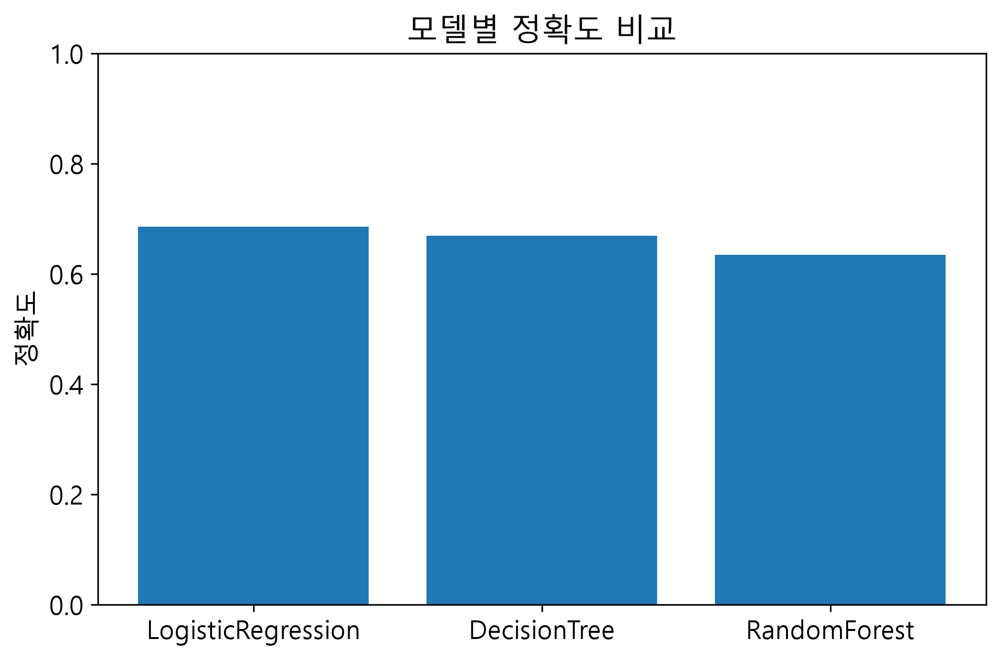
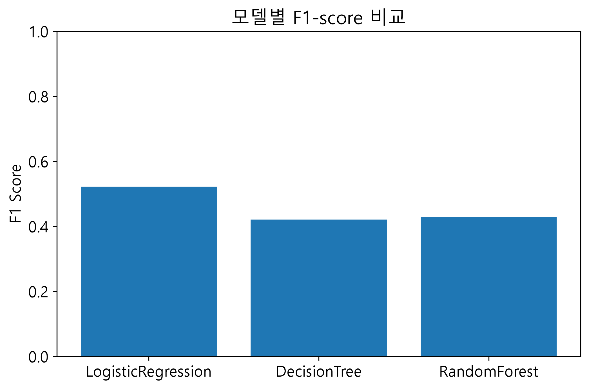
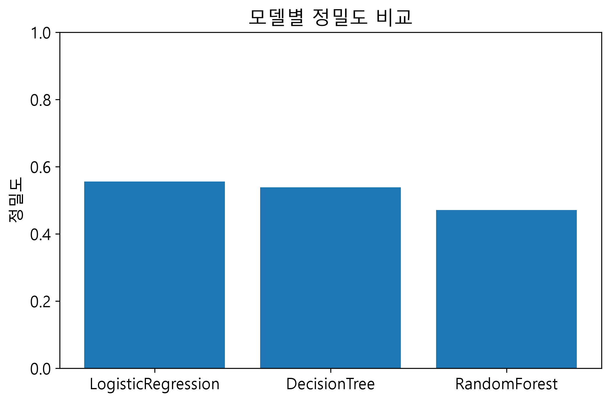
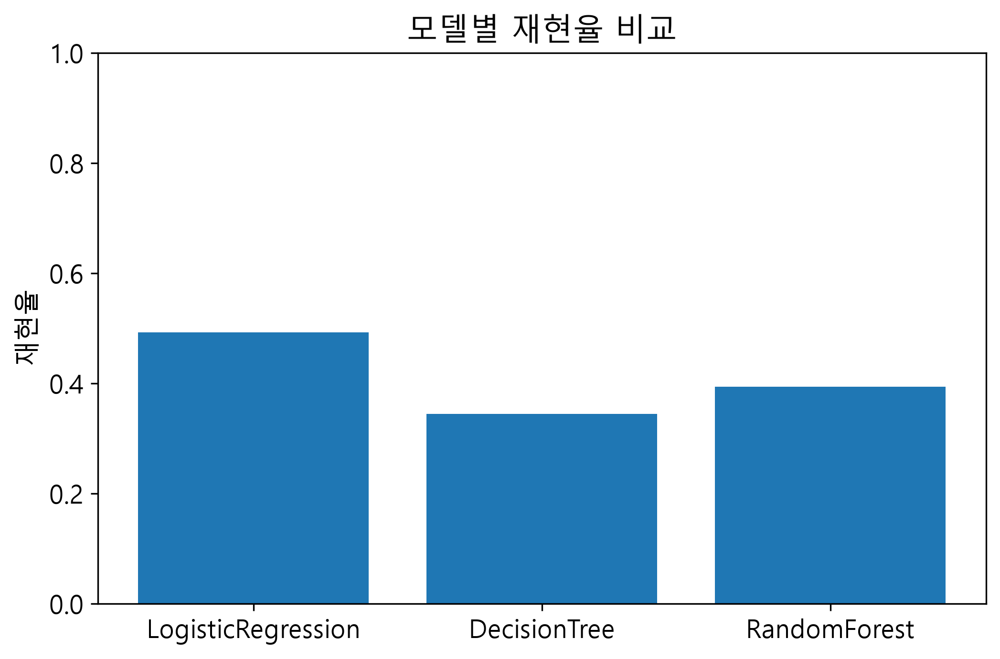
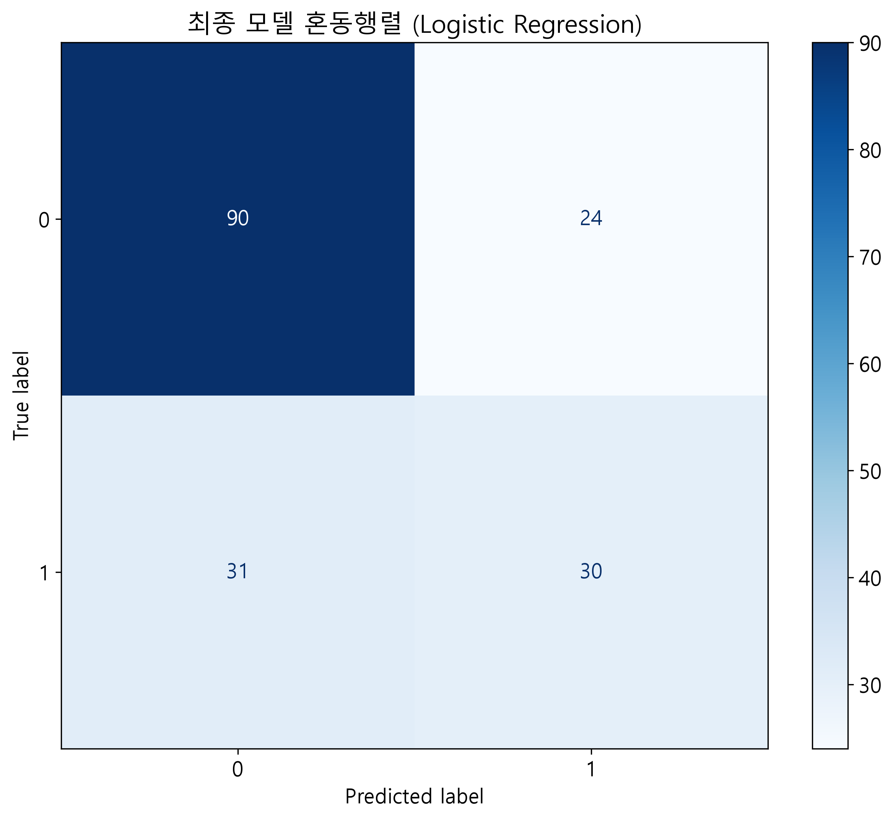
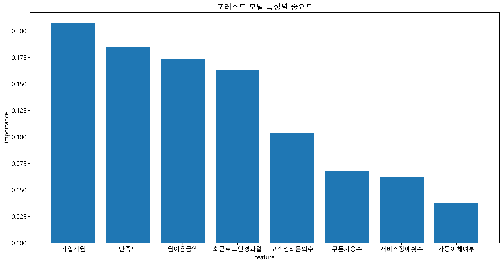

# Team 1 머신러닝 미니프로젝트 보고서

## 1. 프로젝트 개요
- 주제: 고객 이탈 예측
- 문제 유형: 분류(Classification)
- 업무 목적: 이탈 가능성이 높은 고객을 사전에 찾아 유지 활동의 우선순위를 정합니다.
- 팀원: 박세정, 최준혁
- 역할 분담: 
- 전처리,시각화(최준혁)/모델생성,시각화(박세정)

## 2. 데이터 이해
- 데이터 행 수: 700
- 데이터 열 수: 9
- Target: `이탈여부`
- 주요 특성: 가입개월, 만족도, 월이용금액, 최근로그인경과일 — 이탈여부에 대한 영향력이 가장 큰 4개 특성
- 결측치가 있는 컬럼: 이탈여부를 제외한 8개 컬럼(가입개월, 월이용금액, 고객센터문의수, 최근로그인경과일, 자동이체여부, 쿠폰사용수, 서비스장애횟수, 만족도) 모두에 결측치가 존재
- 데이터에서 처음 확인한 특징 2~3개:
- 결측치가 전반적으로 소량 분산되어 있다.
- 변수 스케일 차이가 크다.
- 클래스 불균형 가능성이 있다.

## 3. 데이터 전처리
- 결측치 처리 방법: '가입개월', '월이용금액', '최근로그인경과일', '만족도' => 중앙값 대체 /'고객센터문의수', '쿠폰사용수', '서비스장애횟수' => 0으로 대체 /'자동이체여부'는 최빈값으로 대체
- 이 방법을 선택한 이유: 연속형 변수, 이상치 영향을 줄이기 위해서 중앙값으로 대체,
횟수와 관련된 컬럼들은 결측을 "발생 안 함"으로 간주, 이진 변수이기 때문에 최빈값으로 대체
- X에 사용한 컬럼: csv파일로 받은 컬럼
- y에 사용한 컬럼: 이탈여부 컬럼 생성
- 학습/테스트 분리 비율: 학습 75% / 테스트 25% 
    트레인과 테스트 비율 동일
## 4. 모델 구현 및 비교
사용한 모델:
1. LogisticRegression
 - 시그모이드 함수로 0~1으 값을 구한뒤 0.5를 기준으로 판단
2. DecisionTreeClassifier
 - 특정 기준을 통해 데이터를 여러 그룹으로 쪼갬
3. RandomForestClassifier
   - 여러개의 의사결정을 통해 다수결 투표로 종합
### 모델별 성능 평가 결과

| 모델명 | 정확도 (Accuracy) | 정밀도 (Precision) | 재현율 (Recall) | TN | FP | FN | TP |
| :--- | :---: | :---: | :---: | :---: | :---: | :---: | :---: |
| **LogisticRegression** | **0.6857** | **0.5556** | **0.4918** | 90 | 24 | 31 | 30 |
| **DecisionTree** | 0.6686 | 0.5385 | 0.3443 | 96 | 18 | 40 | 21 |
| **RandomForest** | 0.6343 | 0.4706 | 0.3934 | 87 | 27 | 37 | 24 |

  

## 5. 시각화 결과
### 그래프 1
- 그래프 이름: 모델별 정확도 비교
- 해석: 정확도가 가장 높은 것을 쉽게 비교 할 수 있다

- 
### 그래프 2
- 그래프 이름:모델별 F1-score 비교
- 해석: 세 모델의 F1-score를 비교한 결과 Logistic Regression이 0.522로 가장 높았고, Random Forest(0.429), Decision Tree(0.420) 순으로 나타났다.
Logistic Regression은 두 모델보다 약 0.1 높은 수치를 기록해 상대적으로 우수한 성능을 보였다.

- 
### 그래프 3
- 그래프 이름: 모델별 정밀도 비교
- 해석: 정밀도가 가장 높은것을 쉽게 비교할수 있다

- 
### 그래프 3
- 그래프 이름:모델별 재현율 비교
- 해석: 재현율이 가장 높은 것을 쉽게 비교할 수 있다

- ### 그래프 4
- 그래프 이름:최종 모델 혼동행렬
- 해석: 실제 유지 고객 114명 중 90명을 정확히 예측했고(TN), 24명을 이탈로 잘못 예측했다(FP).
실제 이탈 고객 61명 중에서는 30명만 정확히 예측했고(TP), 31명을 유지로 잘못 예측했다(FN)
FN(31건)이 TP(30건)와 비슷한 수준으로, 실제 이탈 고객의 약 절반을 놓치고 있다는 한계가 드러난다.

- 
- 
### 그래프 5
- 그래프 이름: 랜덤 포레스트 특성 중요도 그래프
- 
- 
- 해석: 가입개월(0.207), 만족도(0.185), 월이용금액(0.174), 최근로그인경과일(0.163) 순으로 이탈여부에 대한 영향력이 컸다.
반면 자동이체여부(0.038), 서비스장애횟수(0.062)는 상대적으로 영향력이 낮았다. 
이는 가입 기간이 짧고 만족도가 낮을수록, 최근 로그인 이력이 오래될수록 이탈 가능성이 높아짐을 시사한다.
---

## 6. 종합 분석 의견

* **최고 성능 모델**: **LogisticRegression**
* **평가 요약**:
  * **LogisticRegression**: 정확도(68.57%), 정밀도(55.56%), 재현율(49.18%)  세 모델 중 가장 높은 확률을 가지고 있다.

    
## 7. 업무 관점 해석

* **이 모델을 실제 업무에 적용한다면**:
  * 이탈 가능성이 가장 높은 위험 고객을 사전에 선별하고, 해당 고객들의 이용 패턴을 다각도로 분석하여 맞춤형 해결책 및 케어 방안을 수립할 수 있습니다.
* **기대 효과**:
  * 이탈 징후가 보이는 고객에게 선제적으로 다가가 맞춤 혜택과 서비스를 제공함으로써 브랜드 신뢰도를 제공하고, 궁극적으로 **고객 이탈률을 효과적으로 낮출 수 있습니다.**
* **잘못된 예측이 발생했을 때 생길 수 있는 문제**:
  * **FN (실제 이탈자를 유지로 판단한 경우)**: 이탈 위험 고객을 놓치게 되어 적절한 방지 조치를 취하지 못하고, 이는 곧 고객 유출로 이어져 **직접적인 매출 감소 및 고객 확보 비용 증가**라는 큰 손실이 발생할 수 있습니다.
  * 

## 8. 프로젝트 한계 및 개선점

* ** 현재 데이터/모델의 한계 **: 
* 재현율이 0.492로 실제 이탈 고객의 절반 가까이를 놓치고 있다.
Logistic Regression은 선형 결정 경계를 가정하는 모델이라 변수 간 복잡한 비선형 상호작용을 포착하지 못하는 한계가 있으며, 
데이터 표본 수(700건)가 제한적이라 일반화 성능에 대한 추가 검증이 필요하다.
* **추가하면 좋을 데이터**:
  *  고객의 상세 이용 패턴(ex:서비스 이용 빈도 ) , 경쟁사 이동 여부 등 이탈과 직접 관련된 추가 특성이 있다면 예측력을 높일 수 있을 것이다.
* **추가로 시도해 보고 싶은 방법**:
  * 하이퍼파라미터 튜닝(GridSearchCV 등)을 통한 Decision Tree/Random Forest 성능 개선 및 KNN 등 추가 모델과의 비교

## 9. 최종 결론

본 프로젝트는 고객 데이터를 기반으로 **이탈 위험군을 사전에 식별하고, 선제적인 이탈 방지 대책을 수립**하여 고객 유효율(Retention)을 극대화하고자 수행되었습니다. 이를 위해 **LogisticRegression, DecisionTreeClassifier, RandomForestClassifier** 총 3가지 머신러닝 분류 모델을 구축하고 다각도로 성과를 비교 분석했습니다.

최종 모델로는 정확도를 비롯해 전반적인 평가 지표에서 가장 뛰어난 예측 성능을 검증받은 **LogisticRegression**을 선정했습니다. 구축된 시스템은 향후 신규 데이터가 업데이트될 때마다 **고객별 이탈 위험도를 실시간으로 산출**하며, 마케팅 및 CS 팀이 고위험군 고객을 대상으로 맞춤형 프로모션 및 1:1 Care 등 **즉각적인 이탈 방지 조치를 실행하는 핵심 의사결정 도구**로 활용될 수 있습니다.
