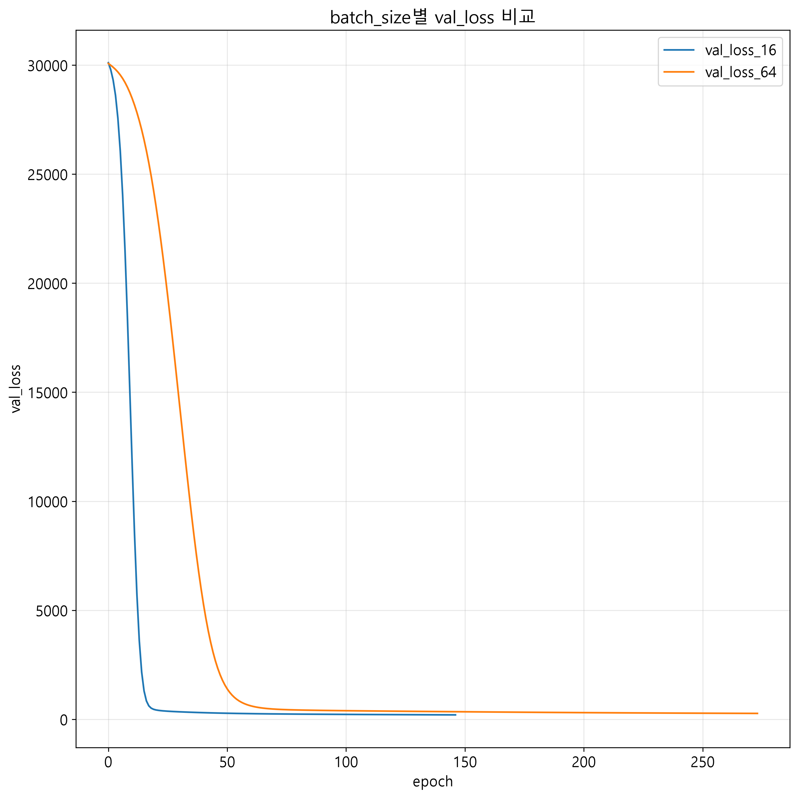
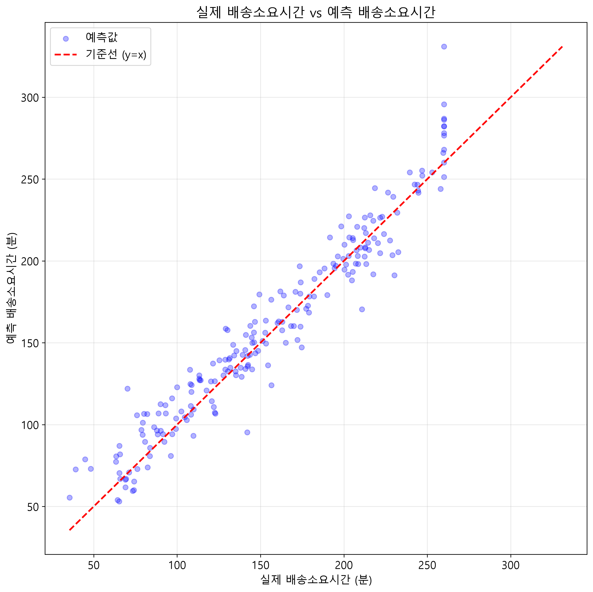

Team 2 데일리 딥러닝 프로젝트 보고서
1. 프로젝트 개요
프로젝트명: 배송 소요시간 예측
문제 유형: 회귀
사용 모델: Dense
팀원: 박세정, 이승우
역할 분담: 코드 작성 후 내용 통합 후 수정 및 보완
2. 데이터 구조
데이터 파일: team2_data.csv

입력 X의 shape: (850, 7)

정답 y의 shape: (850, )

각 축(axis)의 의미:

             X의 행(axis=0): 배송 데이터 850건
             X의 열(axis=1): 각 데이터가 가지고 있는변수 
             (배송거리_km, 주문상품수, 출고대기시간_분, 교통혼잡도, 비여부, 기사경력_년, 야간여부)
Target 또는 정답의 의미:

배송소요시간_분

변수의 입력 특성을 이용하여 '배송소요시간_분'을 예측

타겟인 '배송소요시간_분' 에는 결측치가 없었고, 입력 특성에 결측치가 존재하여 중앙값으로 대체 처리하였다.

3. 모델 구조
Input shape: (7,)
사용한 주요 Layer:
Dense(32)
Dense(16)
Dense(1)
은닉층 Activation: relu
출력층 Activation: linear
Loss Function: MSE
Optimizer: Adam
Learning Rate: Adam 기본 설정 0.001
전체 파라미터 수: 801
model.summary()에서 확인한 핵심
Dense(32): 256개
Dense(16): 528개
Dense(1): 17개
4. 학습 설정
Epoch: 300

Batch Size:

두 모델의 Batch Size를 각 16 / 64 로 비교

Validation 방식: validation_split=0.2

Dropout: 사용x

EarlyStopping monitor: val_loss

EarlyStopping patience: 8

실제 수행된 Epoch 수:

      Batch Size(16) = 147  
      Batch Size(64) = 274
5. 학습곡선 분석
Train Loss / Validation Loss
관찰 내용:

    Batch Size 16의 마지막 Validation Loss는 약 203.95이다.
    Batch Size 64의 마지막 Validation Loss는 약 271.02이다.
    따라서 이번 실험에서는 Batch Size 16의 Validation Loss가 더 낮았다.
과적합 여부: 격차가 크지 않고 비슷하게 감소하여 과적합이 발생지 않음

EarlyStopping이 동작했다면 종료 시점:

두 실험 모두 Epoch을 100으로 설정했을 때는 종료되지 않고 동작했으며, 300 Epoch으로 설정했을때 Batch Size(16)는 147번, Batch Size(64)는 274번 동작 하고 조기 종료하였다.

추가 지표
관찰 내용: Batch Size 16: MAE: 12.19 RMSE: 16.72 Batch Size 64: MAE: 16.37 RMSE: 21.40
Batch Size 16이 Batch Size 64보다 MAE와 RMSE 모두 낮게 나타났다.

6. 최종 성능
사용한 평가 지표: MSE, MAE, RMSE
최종 결과:
설정	16	64
MSE	244.02	305.66
MAE	11.80	12.91
RMSE	15.62	17.48
소요시간	16.39	22.58
수행 epoch수	147	274
7. 시각화 결과
그래프 1

제목:batch_size별 val_loss 비교

해석:

Batch Size 16과 Batch Size 64의 Epoch별 Validation Loss 변화를 비교한 그래프이다. 그래프를 통해 두 Batch Size에서 검증 데이터에 대한 손실이 어떻게 변화하는지 확인할 수 있다. Validation Loss가 낮을수록 검증 데이터에 대한 예측 오차가 작다는 의미이므로, 두 설정 중 더 낮은 값을 보이는 설정을 더 좋은 학습 설정으로 판단하였다

그래프 2

제목: (Batch Size 16)실제 배송소요시간 vs 예측 배송소요시간

해석:

실제 배송 소요시간을 X축, 모델이 예측한 배송 소요시간을 Y축으로 설정한 산점도이다.
그래프에 표시한 y=x 기준선에 점들이 가까울수록 실제값과 예측값이 비슷하다는 의미이다.
따라서 점들이 기준선 주변에 많이 분포할수록 모델의 예측 성능이 좋다고 해석할 수 있다.
8. 모델 선택 및 해석
최종적으로 선택한 모델/설정:

Dense회귀 모델(Optimizer는 Adam, Loss Function은 MSE)
model1(Batch Size 16)
선택 근거: Validation Loss와 MAE, RMSE의 수치가 더 낮으며 더 좋은 예측 결과를 보여주기 때문

다른 모델/설정과 비교한 차이:

설정	16	64
MSE	244.02	305.66
MAE	11.80	12.91
RMSE	15.62	17.48
소요시간	16.39	22.58
수행 epoch수	147	274
데이터 구조와 이 모델이 잘 맞는 이유:
배송거리, 주문 상품 수, 출고대기시간 등 표 형태의 수치 데이터이므로
Dense 신경망을 이용하여 여러 입력 특성과 배송 소요시간 사이의 관계를 효과적으로 학습할 수 있다.
9. 한계와 개선 아이디어
현재 데이터/모델의 한계: 현재 데이터는 수업용으로 생성된 가상 데이터이므로 실제 배송 환경을 완전히 반영하기 어렵다. 입력 데이터에 포함되지 않은 다른 실제 배송 변수들이 존재할 수 있다.

추가로 시도해 볼 설정: Batch Size에 따른 성능 차이를 추가로 비교할 수 있다. Epoch 및 EarlyStopping 조건을 변경하여 학습 결과를 비교할 수 있다.

실제 업무에 적용하려면 필요한 데이터: 실제 배송거리 주문상품 수 출고 대기시간 교통 상황 날씨 기사 경력 배송 시간대 실제 배송 소요시간 등

10. 최종 결론
아래 내용을 포함하여 5~7줄로 작성하세요.

어떤 데이터를 사용했는가?
입력 shape는 무엇을 의미하는가?
어떤 모델을 사용했는가?
어떤 학습 제어 방법을 적용했는가?
최종 결과를 어떻게 해석할 수 있는가?
이번 프로젝트에서는 배송거리, 주문상품수, 출고대기시간, 교통혼잡도 등의 7개 입력 특성을 이용하여 배송 소요시간을 예측하였다. 입력 데이터의 shape는 (850, 7)이며, 850건의 배송 데이터와 7개의 입력 특성을 의미한다. 모델은 Dense(32) → Dense(16) → Dense(1) 구조의 Dense 회귀 신경망을 사용하였고 학습 과정에서는 MSE 손실 함수와 optimizer Adam을 사용하고, Validation Loss를 기준으로 EarlyStopping을 적용하였다. Batch Size 16과 64를 비교한 결과 Batch Size 16의 Validation Loss, MAE, RMSE가 모두 더 낮았다. 따라서 이번 실험에서는 Batch Size 16 설정이 배송 소요시간 예측에 더 적합한 결과를 보였다.